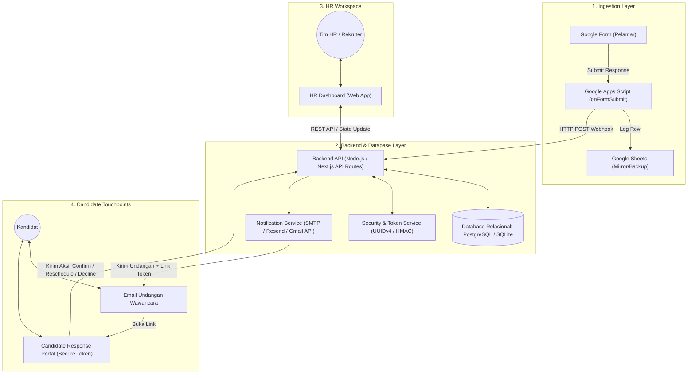
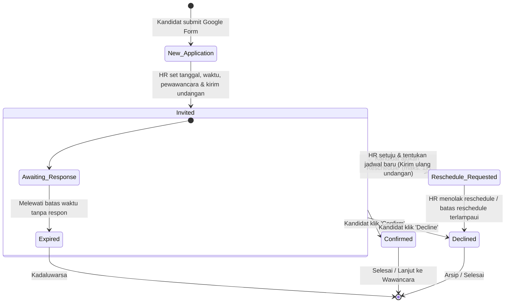
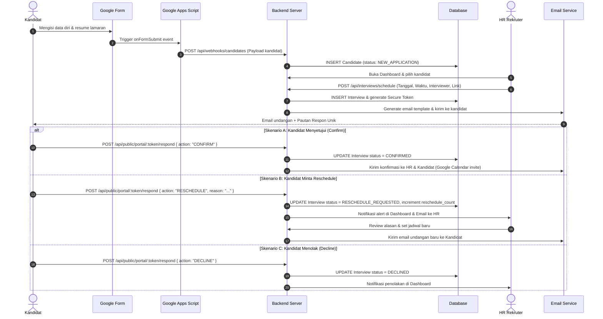
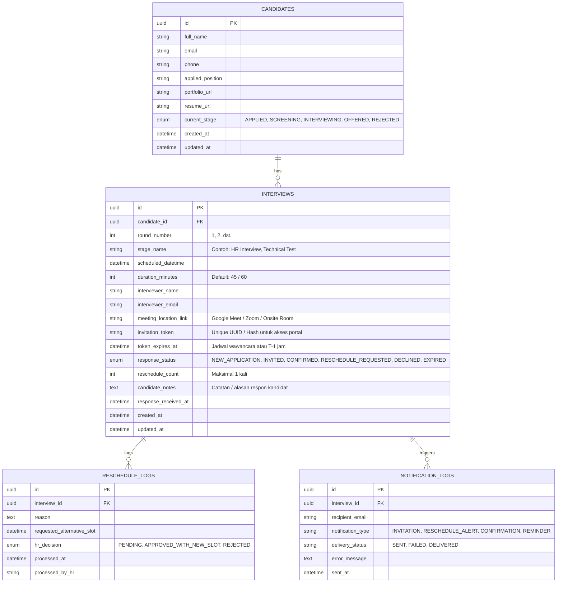

# Dokumen Desain Sistem: Konfirmasi Jadwal Wawancara Kandidat

Dokumen spesifikasi kebutuhan, arsitektur sistem, dan alur kerja integrasi Google Form dengan Dashboard HR.

---

## 1. Arsitektur Tingkat Tinggi (High-Level Architecture)

---

## 2. Diagram Alur & Transisi Status (State Machine)

### 2.1 State Transitions

### 2.2 Sequence Diagram: Alur End-to-End

---

## 3. Desain Skema Basis Data (Database Schema)

---

## 4. Aturan Bisnis & Mekanisme Validasi (Business Rules)

1. **Kontrol Jadwal Eksklusif di HR**: Kandidat hanya dapat mengajukan permohonan *reschedule* disertai alasan tertulis. Kandidat **tidak dapat** langsung menetapkan jadwal baru secara otomatis tanpa verifikasi dan persetujuan HR.
2. **Batas Reschedule Maksimal 1 Kali**: Sistem secara terprogram menonaktifkan opsi *Reschedule* jika atribut `reschedule_count >= 1`. Percobaan permohonan kedua akan diblokir dengan pesan petunjuk untuk menghubungi HR secara langsung.
3. **Keamanan Token Respon & Penguncian Akses**:
   - Pautan respon yang dikirimkan ke email kandidat menggunakan format: `https://domain.com/portal/interview/{invitation_token}`.
   - Token hanya berlaku satu kali untuk respon final (**Confirm** atau **Decline**).
   - Token memiliki batas kedaluwarsa otomatis (`token_expires_at = scheduled_datetime` atau waktu yang ditentukan HR).
   - Setelah direspon final, akses ke tautan akan menampilkan status kartu ringkasan tanpa tombol aksi untuk mencegah *double submission*.
4. **Validasi Data Awal Google Form**:
   - Regex validation ketat pada Google Form untuk email dan nomor WhatsApp/telepon internasional/nasional (contoh: `^(\+62|62|0)8[1-9][0-9]{6,11}$`).

---

## 5. Spesifikasi Antarmuka Pengguna (UI / UX Wireframe)

### 5.1 Dashboard HR (Admin Interface)
- **Header & Metric Cards**: Total Kandidat Masuk, Menunggu Penjadwalan, Menunggu Konfirmasi (`Invited`), Terkonfirmasi (`Confirmed`), Reschedule Diminta (`Reschedule Requested`).
- **Tabel Kandidat & Filter**: Filter posisi, status, tanggal. Aksi cepat: Jadwalkan Wawancara, Tinjau Reschedule, Detail Kandidat.
- **Modal Penjadwalan**: Pemilihan tanggal & waktu, pewawancara, tautan Google Meet, preview email.
- **Drawer Peninjauan Reschedule**: Tampilan alasan kandidat, form penetapan jadwal baru pengganti.

### 5.2 Portal Respon Kandidat (Mobile-First Landing Page)
- **Kartu Ringkasan Undangan**: Nama, posisi, tanggal, jam, zona waktu, platform wawancara.
- **Tiga Tombol Aksi**:
  - `[Konfirmasi Hadir]` (Hijau): Konfirmasi 1 klik.
  - `[Ajukan Reschedule]` (Oranye): Form alasan wajib diisi; dinonaktifkan bila sudah pernah reschedule 1x.
  - `[Tolak Undangan]` (Merah): Konfirmasi penolakan proses.
- **Status State**: Halaman sukses informatif dengan konfirmasi status terkini dan instruksi kalender.

---

## 6. Spesifikasi API (API Contracts)

| Method | Endpoint | Deskripsi | Akses |
|---|---|---|---|
| `POST` | `/api/webhooks/google-form` | Menerima data pendaftaran baru dari Google Apps Script | Webhook Secret Key |
| `GET` | `/api/dashboard/metrics` | Statistik agregat untuk kartu metriks HR | HR Session |
| `GET` | `/api/candidates` | Daftar seluruh kandidat dengan filter & pagination | HR Session |
| `GET` | `/api/candidates/:id` | Detail data lengkap kandidat & riwayat wawancara | HR Session |
| `POST` | `/api/interviews/schedule` | Membuat sesi wawancara, generate token, dan kirim email | HR Session |
| `GET` | `/api/public/portal/:token` | Mengambil detail wawancara untuk halaman portal kandidat | Publik (Validated by Token) |
| `POST` | `/api/public/portal/:token/respond` | Mengirimkan respon kandidat (`CONFIRM`, `RESCHEDULE`, `DECLINE`) | Publik (Validated by Token) |
| `POST` | `/api/interviews/:id/resolve-reschedule` | HR menyetujui alasan dan menentukan jadwal pengganti | HR Session |

---

## 7. Rekomendasi Stack Teknologi

- **Framework**: **Next.js 14+ (App Router)** atau **React + Node.js (Express)**
- **Database & ORM**: **PostgreSQL / SQLite** dengan **Prisma ORM**
- **Styling**: **Tailwind CSS** + komponen UI modern
- **Email Service**: **Nodemailer / Resend / Gmail API**
- **Integrasi Google Form**: **Google Apps Script** (Trigger `onFormSubmit`)
